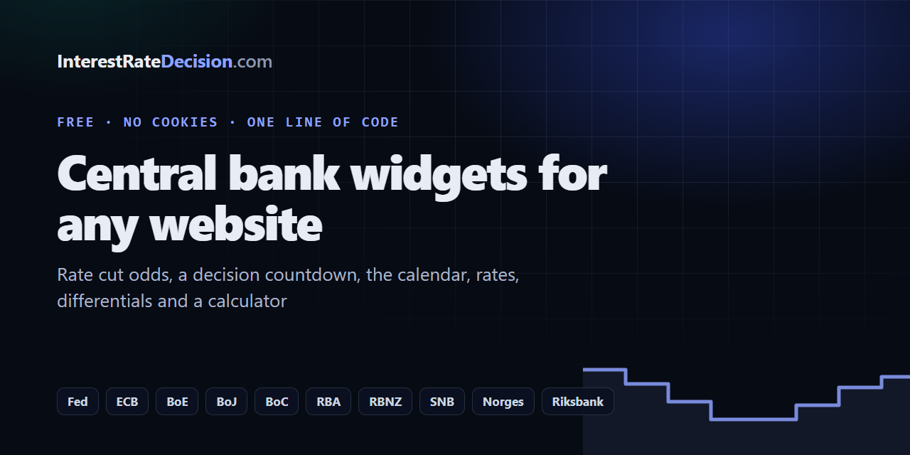

# Central Bank Widgets: Free Forex Economic Calendar, Rate Odds and Countdown Widgets for Websites

[](https://interestratedecision.com/widget/)

[](https://interest-rate-decision.github.io/widgets/)
[](https://interestratedecision.com/widget/)
[](wordpress/)
[](#privacy)

**Free, live central bank widgets for any website or blog**: a forex economic calendar of interest rate decisions, a countdown to the next FOMC, ECB or Bank of England decision, rate cut odds for each meeting, a table of every central bank's interest rate, interest rate differentials for currency pairs, and a rate cut calculator for mortgages and savings. One line of code, no sign-up, no API key, no cookies.

Data from **[InterestRateDecision.com](https://interestratedecision.com/)**, updated within minutes of each decision of the Fed, ECB, Bank of England, Bank of Japan, Bank of Canada, RBA, RBNZ, SNB, Norges Bank and Riksbank.

**[See them live](https://interest-rate-decision.github.io/widgets/)** · **[Build yours with a live preview](https://interestratedecision.com/widget/)**

## Contents

- [The widgets](#the-widgets)
- [Add one to your site](#add-one-to-your-site)
- [Options](#options)
- [WordPress](#wordpress)
- [Webflow, Wix, Squarespace, Ghost, Blogger](#other-platforms)
- [Privacy](#privacy)

## The widgets

| Widget | `data-widget` | What it shows | Good for |
| --- | --- | --- | --- |
| **Rate odds** | `odds` | One bank's chance of a cut, hold or hike at each meeting ahead, from the record of every decision since 2008 | "Will the Fed cut rates?" posts |
| **Countdown** | `countdown` | The next central bank decision in big figures, to the second, with what is expected | Sidebars, trading blogs on decision day |
| **Calendar** | `next` | The next interest rate decisions with live countdowns and the consensus | A forex economic calendar widget |
| **Rates table** | `rates` | Every central bank's policy rate, last move, 3-year line and next meeting | "Interest rates by country" pages |
| **Rate differential** | `differential` | Two currencies' policy rates and the gap between them since 2015 | EUR/USD, USD/JPY and carry trade analysis |
| **Rate cut calculator** | `calculator` | What a rate cut or hike does to a loan payment and to savings interest | Personal finance and mortgage blogs |

## Add one to your site

Paste this where the widget should appear:

```html
<div class="ird-widget" data-widget="odds" data-bank="fed"><a href="https://interestratedecision.com/">InterestRateDecision.com</a></div>
<script async src="https://interestratedecision.com/embed.js"></script>
```

The script turns the `div` into the widget and keeps its height right as it changes. Several widgets on one page need the script once.

Where scripts are not allowed, frame the widget directly:

```html
<iframe src="https://interestratedecision.com/embed/countdown/" width="100%" height="330" style="border:0" loading="lazy" title="Next central bank decision"></iframe>
```

## Options

As `data-*` attributes (or `?name=value` on the iframe's address):

| Attribute | Values | Widgets |
| --- | --- | --- |
| `data-bank` | `fed`, `ecb`, `boe`, `boj`, `boc`, `rba`, `rbnz`, `snb`, `norges`, `riksbank` | odds, countdown, next |
| `data-banks` | a list: `fed,ecb,boe` | rates |
| `data-n` | rows or meetings, 1–8 | odds, next |
| `data-pair` | `EURUSD`, `GBPUSD`, `USDJPY`, `AUDUSD`, `USDCAD`, `NZDUSD`, `USDCHF`, `EURGBP`, `EURJPY`, `GBPJPY`, `AUDJPY`, `AUDNZD`, `EURCHF`, `EURNOK`, `EURSEK`, `CADJPY`, `GBPCHF`, `NZDJPY` | differential |
| `data-theme` | `light`, `dark` or `auto` (follows the reader) | all |
| `data-accent` | a hex colour without `#`, such as `0e9f7e` | all |
| `data-odds="1"` | a thin odds bar on each decision | next |
| `data-spark="0"` | hide the 3-year lines | rates |
| `data-border="0"` | no border | all |

Examples:

```html
<!-- the next five decisions, dark, with odds -->
<div class="ird-widget" data-widget="next" data-n="5" data-odds="1" data-theme="dark"><a href="https://interestratedecision.com/">InterestRateDecision.com</a></div>

<!-- the EUR/USD rate differential in your brand colour -->
<div class="ird-widget" data-widget="differential" data-pair="EURUSD" data-accent="f5a524"><a href="https://interestratedecision.com/">InterestRateDecision.com</a></div>

<!-- the rate cut calculator -->
<div class="ird-widget" data-widget="calculator"><a href="https://interestratedecision.com/">InterestRateDecision.com</a></div>
<script async src="https://interestratedecision.com/embed.js"></script>
```

## WordPress

The plugin in [`wordpress/`](wordpress/) adds a shortcode and a sidebar widget:

```
[ird_widget type="odds" bank="fed"]
[ird_widget type="countdown"]
[ird_widget type="rates" banks="fed,ecb,boe,boj"]
[ird_widget type="calculator" theme="dark"]
```

Or, with no plugin, paste the code into a **Custom HTML** block.

<h2 id="other-platforms">Webflow, Wix, Squarespace, Ghost, Blogger</h2>

- **Webflow**: an Embed element. **Wix**: Embed Code → Embed HTML. **Squarespace**: a Code block.
- **Ghost**: an HTML card. **Blogger**: Layout → Add a Gadget → HTML/JavaScript.
- **Notion, forums, newsletters** that block scripts: the iframe code, or a link to the widget's address.

## Privacy

The widgets set no cookie, store nothing in the reader's browser and load nothing from anyone else. A view is counted like a page of the site: a daily total with the name of the site showing it, nothing about the reader ([privacy](https://interestratedecision.com/privacy/)).

## Licence

Free for any site, commercial or not. Please keep the plain link to InterestRateDecision.com under each widget. Code in this repository: MIT.

---

Related: [Central bank interest rates dataset](https://github.com/Interest-Rate-Decision/central-bank-interest-rates) · [Interest rate decisions API for JavaScript and Python](https://github.com/Interest-Rate-Decision/interest-rate-decisions) · [Rate cut odds](https://interestratedecision.com/rate-odds/) · [Central bank calendar](https://interestratedecision.com/calendar/)
